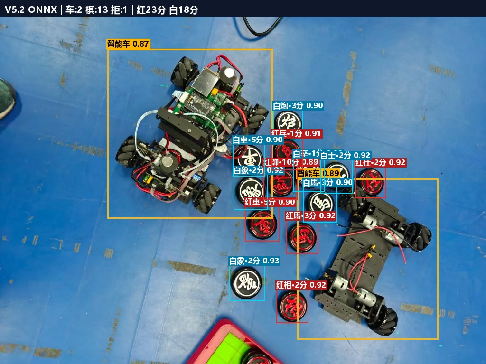
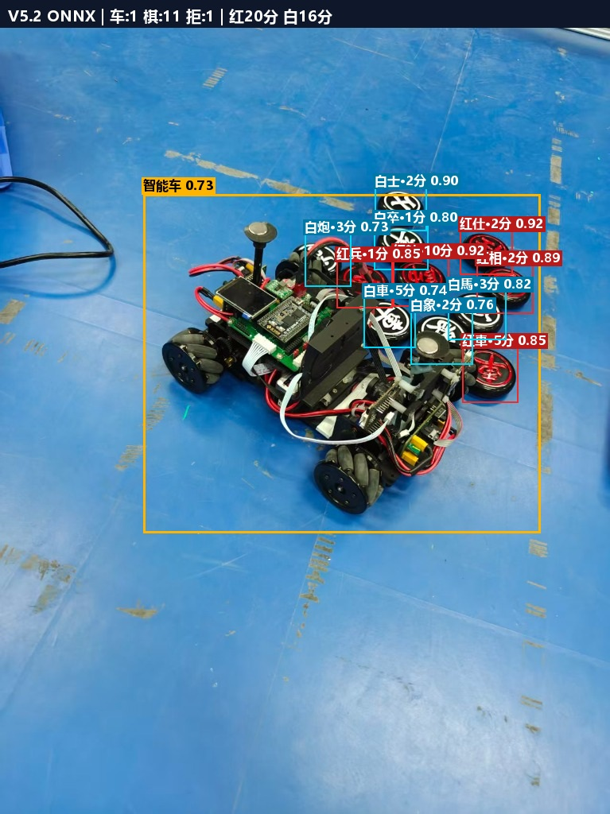
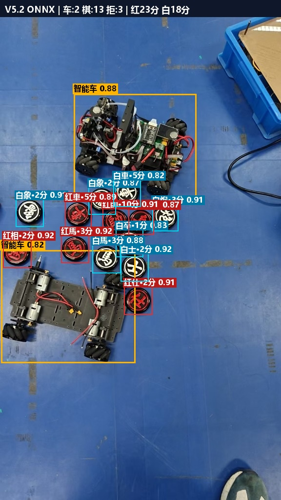

# 第十五届全国大学生光电设计竞赛——智能车光电象棋对抗 完整开源方案（V5.2）

面向 **第十五届全国大学生光电设计竞赛（实物赛道·赛题1：智能车光电象棋对抗）** 的端到端实拍两阶段视觉识别、分值计分、测距标定与实车部署开源方案。

支持同时识别 **黑底红字 / 黑底白字双面中国象棋（14 类精细棋种 + 10 类官方比赛分值档，0–360° 全角度旋转）** 以及 **竞赛智能车（含裸板绿 PCB 麦轮车、多车同框与远景小车）**。

> **开源范围说明**：本项目仅公开**纯推理部署专用的多分辨率静态 ONNX 权重（`.onnx`）**及**零 PyTorch 依赖**的 ONNX Runtime 推理、视频时序跟踪与相机测距标定全套代码，不提供可续训 `.pt` 检查点与原始训练数据集。所有 `.onnx` 均为静态 `opset=12` 简化图，可直接部署于 ONNX Runtime、TensorRT、RKNN、OpenVINO、OpenCV DNN 等主流车载平台。

---

## 一、V5.2 实拍效果预览（纯 ONNX Runtime 端到端直出）

| 俯拍双车 13 棋（`2/2 车 · 13/13 全对 · 0 误报`） | 斜拍遮挡盲测（`1/1 车 · 11/11 全对 · 0 电线误报`） | 全新双车视角（`红 23 分 / 白 18 分 · 跨视角完全一致`） |
| :---: | :---: | :---: |
|  |  |  |

---

## 二、V5.2 核心升级与盲测对比

相较于初版 `v1.0.0` 及中间迭代版本，**`v5.2.0`** 融合了实拍定向数据、**14 枚官方比赛棋子原版 3D 字模**（含实体黑底白字**火字旁「炮」**、粗体「白車」「白卒」「红相」）与真实车体线束/接头/麦轮/鞋子硬负样本，在完全未参与训练的现场盲测集（`F03 + F06`）上实现全面突破：

| 评测维度（未见实拍盲测集 `F03 + F06`） | V5.1 `v8s`（旧） | **V5.2 `v8s`（精度旗舰）** | **V5.2 `v8n`（车载高速）** |
| :--- | :---: | :---: | :---: |
| Stage 1 实拍定位 `Precision / Recall / mAP50` | `0.934 / 0.845 / 0.917` | **`0.975 / 0.963 / 0.990`** | **`0.946 / 0.950 / 0.977`** |
| Stage 2 实拍切片字面准确率 | `63.64%` | **`81.82%`（+18.18%）** | **`81.82%`（+18.18%）** |
| **电线 / XT60 接头 / 麦轮 / 鞋子真实负样本误报** | `18 / 25` 误报 | **`0 / 25`（100% 拒识）** | **`0 / 25`（100% 拒识）** |
| **实拍 `白車 → 白象` 误判** | `2 / 3` | **`0 / 3`（全对）** | **`0 / 3`（全对）** |

### 内置 5 项实战防误检与提速机制（已全部集成至代码）
1. **智能车嵌套框 `IoA` 去重**（`IoA > 0.45` 或 `IoU > 0.30`）：彻底消除单车重复标；
2. **移除车心硬删，改用车身重叠自适应 Stage 2 门控**：落在车体区域内的候选框要求 `s2_conf >= 0.56`（地面 `>= 0.45`），在 **100% 找回车边/轮边白字棋子** 的同时把车上红电线误报清零；
3. **14 类细粒度特征 + 10 类官方分值概率合并**：推理层自动聚合 `P(3分)=P(馬)+P(炮)`、`P(2分)=P(相/象)+P(仕/士)`，支持 `--score-only` 直接按分值输出并实时汇总红/白双方总分；
4. **67 mm 标准棋子单目测距 + 地面单应性标定（[calibrate_camera.py](calibrate_camera.py)）**：输出真实世界 `(X_mm, Y_mm)` 与距离 `dist_cm`，支持物理宽度一致性反误报；
5. **视频流多帧投票与 Stage 2 锁定缓存（[video_tracker.py](video_tracker.py)）**：连续 4 帧高置信锁定后自动复用缓存，实车端到端帧率提升 2×–4×。

---

## 三、V5.2 多分辨率纯推理 ONNX 权重下载（Release `v5.2.0`）

请前往右侧 **[Releases v5.2.0](https://github.com/maoyaoweii/15th-NUCODC-SmartCar-Xiangqi-OpenSource/releases/tag/v5.2.0)** 下载对应算力档位的 `.onnx` 权重（完整校验值见 [SHA256SUMS.txt](SHA256SUMS.txt)）：

### Stage 1 全图定位权重（2 类：`0: chess_piece`, `1: smart_car`）

| 权重文件 | 架构 | 固定输入分辨率 | 体积 | 实拍盲测 mAP50 | 适用硬件 / 场景 |
| :--- | :---: | :---: | :---: | :---: | :--- |
| `stage1_v8s_v52_1024.onnx` | YOLOv8s | `1024 × 1024` | 45.01 MB | **0.990** | **精度旗舰（推荐）**：Jetson Orin / PC GPU / 远景多车 |
| `stage1_v8s_v52_640.onnx` | YOLOv8s | `640 × 640` | 44.75 MB | — | Jetson Orin / NPU 高精度高速 |
| `stage1_v8n_v52_1024.onnx` | YOLOv8n | `1024 × 1024` | 13.04 MB | **0.977** | **车载均衡推荐**：RK3588 / RDK X5 / Jetson Orin Nano |
| `stage1_v8n_v52_640.onnx` | YOLOv8n | `640 × 640` | 12.77 MB | — | 树莓派 5 / 香橙派 / 极致帧率 |

### Stage 2 棋子精细分类权重（14 类：红 7 + 白 7，含官方原版字模与电线负样本）

| 权重文件 | 架构 | 固定输入分辨率 | 体积 | 实拍盲测 / 负样本拒识 | 适用场景 |
| :--- | :---: | :---: | :---: | :---: | :--- |
| `stage2_v8s_v52_512.onnx` | YOLOv8s | `512 × 512` | 44.71 MB | **81.82% / 100% (0/25 FP)** | **精度旗舰（原生 512px）** |
| `stage2_v8s_v52_384.onnx` | YOLOv8s | `384 × 384` | 44.66 MB | — | Jetson / NPU 提速版 |
| `stage2_v8n_v52_512.onnx` | YOLOv8n | `512 × 512` | 12.73 MB | **81.82% / 100% (0/25 FP)** | **车载轻量旗舰（推荐）** |
| `stage2_v8n_v52_384.onnx` | YOLOv8n | `384 × 384` | 12.68 MB | — | 边缘板卡极致帧率 |

---

## 四、类别编号与官方比赛分值映射表

| ID | 英文名 | 中文棋种 | 分值档 | 单枚分值 | ID | 英文名 | 中文棋种 | 分值档 | 单枚分值 |
|---:|---|---|:---:|---:|---:|---|---|:---:|---:|
| `0` | `red_rook` | 红車 | `red_5` | 5 | `7` | `black_rook` | 白車 | `black_5` | 5 |
| `1` | `red_horse` | 红馬 | `red_3` | 3 | `8` | `black_horse` | 白馬 | `black_3` | 3 |
| `2` | `red_elephant` | 红相 | `red_2` | 2 | `9` | `black_elephant` | 白象 | `black_2` | 2 |
| `3` | `red_advisor` | 红仕 | `red_2` | 2 | `10` | `black_advisor` | 白士 | `black_2` | 2 |
| `4` | `red_general` | 红帥 | `red_10` | 10 | `11` | `black_general` | 白將 | `black_10` | 10 |
| `5` | `red_cannon` | 红炮 | `red_3` | 3 | `12` | `black_cannon` | 白炮 | `black_3` | 3 |
| `6` | `red_pawn` | 红兵 | `red_1` | 1 | `13` | `black_pawn` | 白卒 | `black_1` | 1 |

---

## 五、快速上手（纯 ONNX Runtime，无需安装 PyTorch）

### 1. 安装依赖
```bash
pip install -r requirements.txt
```

### 2. 单张图片 / 批量文件夹推理（自动输出 14 类 + 分值汇总 + JSON）
```bash
python infer_onnx_twostage.py \
  --stage1 stage1_v8s_v52_1024.onnx \
  --stage2 stage2_v8s_v52_512.onnx \
  --image your_arena_photo.jpg \
  --out result.jpg \
  --json-out result.json
```

### 3. 车载摄像头 / 视频流实时推理（开启多帧投票 + 单裁剪极速模式 + 按分值显示）
```bash
python infer_onnx_twostage.py \
  --stage1 stage1_v8n_v52_1024.onnx \
  --stage2 stage2_v8n_v52_384.onnx \
  --source 0 \
  --temporal \
  --fast-single-crop \
  --score-only
```

### 4. 67 mm 标准棋子测距与场地坐标标定
```bash
# 1 分钟单目像素宽标定（棋子放镜头正前 50cm，水平框宽 84px）
python calibrate_camera.py --mode monocular --img-width 1280 --z0-cm 50 --w0-px 84 --piece-mm 67 --out calib.json

# 带上标定文件推理，自动输出每颗棋子真实距离 (dist_cm) 与坐标
python infer_onnx_twostage.py \
  --stage1 stage1_v8n_v52_1024.onnx \
  --stage2 stage2_v8n_v52_512.onnx \
  --image your_arena_photo.jpg \
  --calib calib.json \
  --out result_dist.jpg
```

---

## 六、项目文件结构与进阶文档

- `infer_onnx_twostage.py`：零 PyTorch 两阶段 ONNX 推理主程序（支持图片/文件夹/视频/摄像头、自适应去电线门控、14 类 & 10 类分值双输出、测距与 JSON 导出）
- `video_tracker.py`：轻量级多帧目标追踪 + 14 类概率 EMA 投票 + Stage 2 锁定缓存
- `calibrate_camera.py`：67 mm 标准棋子单目宽度测距 & 4 点地面单应性标定工具
- `docs/DEPLOYMENT_AND_CALIBRATION.md`：**[完整工程部署手册](docs/DEPLOYMENT_AND_CALIBRATION.md)**（含 V1→V5.2 避坑演进表、TensorRT/RKNN/OpenVINO 转换命令、地面单应性实操、串口 JSON 协议与 120 秒对抗策略）
- `docs/RULES_AND_TACTICS.md`：**[第十五届光赛官方规则解析与实战战术指南](docs/RULES_AND_TACTICS.md)**（依据 2026-11-17 组委会〔2026〕1 号细则：300mm 挡板 / 2.5kg 修订、二八分值博弈、120s 三阶段状态机、球门防压线/防叠放、尾盘偷家判据与 60s 金球闪电战模式）
- `SHA256SUMS.txt`：V5.2 全部 8 个 ONNX 权重 SHA-256 校验清单

---

## 七、主流车载硬件推理延迟参考

| 车载硬件平台 | 推荐部署引擎 | `s1_v8n_640` | `s1_v8n_1024` | `s2_v8n_384` (单枚) | 开启 `--temporal` 整套端到端 FPS |
| :--- | :--- | :---: | :---: | :---: | :---: |
| **Jetson Orin NX (16GB)** | TensorRT FP16 | ~3.5 ms | ~8.5 ms | ~1.8 ms | **60+ FPS** |
| **Jetson Orin Nano (8GB)** | TensorRT FP16 | ~6.5 ms | ~16 ms | ~3.0 ms | **35–50 FPS** |
| **RK3588 / 香橙派 5 (6 TOPS)** | RKNN INT8 (3核) | ~10 ms | ~25 ms | ~5.0 ms | **25–40 FPS** |
| **地瓜 RDK X5 (10 TOPS)** | BPU INT8 | ~9 ms | ~22 ms | ~4.5 ms | **30–45 FPS** |
| **Intel N100 / 迷你工控机** | OpenVINO FP16 | ~15 ms | ~35 ms | ~6.5 ms | **20–30 FPS** |
| **树莓派 5 (4 核 A76 CPU)** | NCNN / ORT FP32 | ~65 ms | ~160 ms | ~26 ms | **5–10 FPS** |

---

## 八、开源协议

本项目推理与标定代码采用 [MIT License](LICENSE) 开源；ONNX 权重仅供学习、科研及全国大学生光电设计竞赛参考交流使用。
