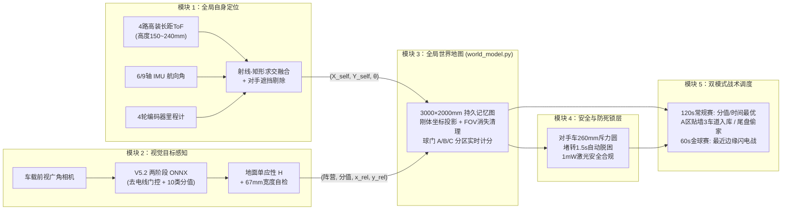

# 第十五届光赛智能车「全局世界模型」完整工程解决方案

本方案面向 **`3000 × 2000 mm` 封闭高挡板（`300 mm`）场地 + 32 枚 `67×17 mm` 棋子 + 120 秒实时对抗**，通过 **「4 路高装长距 ToF + IMU + 编码器」** 与 **「车载视觉 V5.2 ONNX + 单应性投影」** 融合，以极低成本、极低重量构建全场地零漂移全局世界模型（配套零 PyTorch 参考实现见 [world_model.py](../world_model.py)）。

---

## 一、系统总体架构（五大核心模块与分工）



---

## 二、需要哪些模块？分别解决什么核心问题？

| 模块编号 | 模块名称 | 硬件 / 算法组成 | 精准解决的赛场核心痛点 | 输出数据接口 |
| :---: | :--- | :--- | :--- | :--- |
| **M1** | **自身全局定位模块**<br>`ArenaRayCastLocalizer` | 4 路长距 Class 1 ToF（装在 `150–240 mm` 高度）+ IMU（如 BNO085/WT901）+ 编码器 | 1) **消除轮子打滑 120s 累积漂移**（`±1–2 cm` 零漂移）；<br>2) **高于 `17 mm` 棋子、低于 `300 mm` 挡板**，棋子永不干扰测距；<br>3) **自动踢除被对手车挡住的 ToF 通道**（射线残差门控）；<br>4) **推棋入库距后墙精准停距**（40–60 mm 不撞墙不压线） | `(x_mm, y_mm, theta_rad)` + 有效/被挡射线状态 |
| **M2** | **视觉目标感知模块**<br>`infer_onnx_twostage.py`<br>`calibrate_camera.py` | 车载前视定焦相机 + **V5.2 ONNX** + 地面单应性矩阵 `H` | 1) 补齐 4 路 ToF 看不见地上 32 枚矮棋子的盲区；<br>2) 识别 **14 类字面 + 10 类比赛分值（10/5/3/2/1 分）** 与对手 `smart_car`；<br>3) 自适应车身门控（`s2_car_conf=0.56`）+ 67 mm 物理宽度自检，**彻底过滤电线/麦轮/贴纸误报** | 相对车体坐标 `(world_x_mm, world_y_mm, dist_cm)` + `score_pts` |
| **M3** | **全局世界地图与记忆层**<br>`XiangqiWorldModel` | 刚体坐标变换 + 多帧概率投票 + **FOV 视野可见性清理** | 1) **解决小车转身/背对场地后“失忆”**，持续记住高分棋位置与己方球门实时得分；<br>2) **解决旧记忆过期**：若某记忆棋子落入当前相机视野锥内却连续 3 帧未检出（被对手推走），自动从地图删除；<br>3) 实时统计己方球门 **A/B/C 三区** 分布与总分 | 持久棋子列表 + 对手车全局坐标 + 双方实时比分板 |
| **M4** | **安全与防死锁监控层** | 编码器零速堵转检测 + 对手车斥力势场（APF） | 1) **破解“单车自卡不复位”死穴**：持续 1.2–1.5s 位移接近 0 立刻自动倒车 15 cm + 转向 45° 脱困；<br>2) **防恶意冲撞判负**：基于对手全局坐标维护 `R ≥ 260 mm` 动态避障斥力圆；<br>3) 控制推进速度防把棋子铲翘叠放 | 脱困中断信号 / 避障修正速度向量 `(vx, vy, ω)` |
| **M5** | **双模式战术决策器**<br>`recommend_next_action()` | 120s 效用函数状态机 + 60s 金球闪电战拨码模式 | 1) **常规赛拒绝盲搬 1 分兵**：按 `U = (分值 × 置信度) / 预计往返耗时` 优先收割占总分 `71.1%` 的前 7 枚高分棋；<br>2) **A 区贴墙金库 3 车道交替入库**，防自我顶叠与压线；<br>3) **尾盘 25s 落后自动切换偷家清对方球门**；<br>4) **60s 金球赛切换极速模式**，不挑分值 6–9 秒闪电绝杀 | 下一动作指令（`HARVEST` / `RAID_OPPONENT_GOAL` / `GOLDEN_BLITZ` / `PATROL_SCAN`）+ 目标与落点坐标 |

---

## 三、核心数学模型：从传感器到全局坐标

### 1. 4 路 ToF 射线-矩形求交与对手遮挡剔除
将场地建立以中心为原点的全局坐标系：$X \in [-1500, +1500]\text{ mm}$，$Y \in [-1000, +1000]\text{ mm}$。  
对前/后/左/右 4 路激光（相对车体朝向分别为 $0, \pi, +\frac{\pi}{2}, -\frac{\pi}{2}$），在 IMU 航向角 $\theta$ 已知时，无需依赖“车身必须正对墙面”，直接求每条射线与矩形四壁的精确交距 $d_{\text{pred}}(x, y, \theta + \alpha_k)$：

- 若实测距与预测距满足 $d_{\text{meas}} - d_{\text{pred}} < -160\text{ mm}$：说明**该方向被对手智能车挡住**，立刻踢除该通道；
- 对剩余未遮挡通道（$\ge 2$ 路）执行 3 步轻量高斯-牛顿修正，即可把轮式里程计误差持续收敛到 **`±5–15 mm`**（详见 [world_model.py](../world_model.py) 中的 `ArenaRayCastLocalizer`）。

### 2. 视觉观测投影到全局世界地图
当单应性标定给出棋子相对车头的坐标 `(X_cam_right, Y_cam_forward)` 后，一步刚体变换写入全局地图：

$$\begin{bmatrix} X_w \\ Y_w \end{bmatrix} = \begin{bmatrix} X_{\text{self}} \\ Y_{\text{self}} \end{bmatrix} + \begin{bmatrix} \cos\theta & -\sin\theta \\ \sin\theta & \cos\theta \end{bmatrix} \begin{bmatrix} Y_{\text{cam\_forward}} \\ -X_{\text{cam\_right}} \end{bmatrix}$$

---

## 四、球门 `400 × 600 mm` 容量与 A/B/C 安全分区建模

世界模型内置 `classify_goal_zone()` 对球门空间做三级安全分级（规则要求 `67 mm` 棋子完整投影入区、不压线、不叠放）：

- **球门几何容量**：正交网格 `40 枚`、六边形最密堆积 **`50 枚`**（随机推入约 `37–43 枚`）；己方全部 16 枚仅占总面积 `23.5%`，绝不会装不下。
- **三级安全分区（以己方后墙为深度 `0`）**：
  1. **🟢 `GOAL_A_SAFE`（贴墙高安全金库）**：距后墙 `≤ 140 mm`、距中轴 `|y| ≤ 240 mm`，双排可稳放 **`10–14 枚`**。正面直掏完全免疫，专门存放占总分 `71.1%` 的 **7 枚高分棋（1 帅/将 + 2 车 + 2 马 + 2 炮）**，通过左/中/右 3 条车道（`y = -160 / 0 / +160 mm`）交替顶墙入库。
  2. **🟡 `GOAL_B_MID`（中深肉盾缓冲区）**：距后墙 `140–280 mm`，可放 `10–12 枚`，存放 `1–2 分` 棋并在物理上迟滞对手斜切入库。
  3. **🔴 `GOAL_C_EDGE`（近门线/侧线高危区）**：距前门线 `< 120 mm` 或距侧线 `< 60 mm`，易压线判 0 分或被 2 秒扫出，世界模型会将其标记为**待补推入深**而非安全锁定！

---

## 五、硬件选型与避坑清单（面向 15 届检录红线）

1. **4 路 ToF 选型**：
   - ❌ 严禁用 `VL53L0X`（实测稳定量程仅 `1.2 m`，在 `3000 mm` 场地中央必然失效）；
   - ✅ 推荐 **Class 1 1 类安全长距单点激光**（`≤ 1 mW` 符合检录红线）：**`TFmini-S` / `STP-23L` / `TOF400F`**（量程 4–12 m、光斑极窄、50–100 Hz），或 **`VL53L1X`**（4 m 需软件将 SPAD ROI 缩窄为 `4×4` 防止广角扫到地面）。
2. **安装高度红线**：严格装在车身 **`150–240 mm`** 区间（稳超 `17 mm` 棋子且稳低于 `300 mm` 挡板）。
3. **IMU 选型与零漂抑制**：推荐内置卡尔曼融合的 **`BNO085` / `WT901`**；发车前静止 2 秒自动校零，确保航向角 120 秒漂移 `< 1.5°`。
4. **整车轻量化**：本方案相比 360° 机械雷达减重 `150–250 g`，配合碳纤板/3D 打印车身把整车控制在 **`1.3–1.6 kg`**（远低于 `2.5 kg` 上限），保留平局质量决胜优势。

---

## 六、本地运行世界模型自测

```bash
python world_model.py
```

内置仿真测试会依次验证：
1. 任意 `28°` 倾角 + **左侧 ToF 被对手车近距遮挡** 时，自动踢除遮挡射线并把 `(X, Y)` 定位误差收敛至 `< 5 mm`；
2. 视觉相对坐标投影至全局地图与双方球门实时计分；
3. 同一局势下「常规赛高分优先（选 10 分帅）」「60s 金球闪电战（选最近 1 分兵）」「最后 18s 落后自动切换偷家（`RAID_OPPONENT_GOAL`）」三种决策模式全自动切换。
